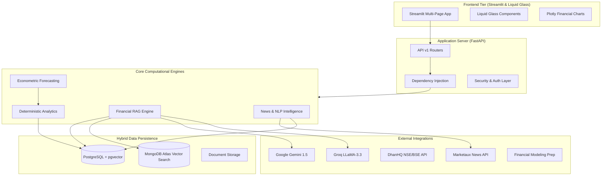

# ALPHANEXUS – System Architecture

## 1. Overview

**ALPHANEXUS** ("See Beyond the Stock Price") is an institutional-grade AI-powered financial intelligence and equity research platform designed for Indian listed equities (NSE/BSE) and global markets.

---

## 2. Tiered Components

1. **Frontend Tier:**
   - Multi-page workspace in Streamlit.
   - Liquid Glass UI design tokens (`backdrop-filter: blur(16px)`).
   - Bi-directional custom React component for fluid navigation.
   - Plotly interactive candlestick and ratio trend charts.

2. **Backend API Tier:**
   - High-throughput asynchronous FastAPI web framework.
   - Pydantic v2 validation and schemas.
   - SQLAlchemy ORM with connection pooling.
   - Modular v1 endpoint routing.

3. **Core Engine Tier:**
   - **Financial RAG Engine:** Sentence Transformers (`BAAI/bge-base-en-v1.5`), semantic table extraction, chunking, and cross-encoder reranking.
   - **Deterministic Financial Engine:** Zero-hallucination math for ROE, ROCE, EBITDA margins, and DuPont breakdown.
   - **News Intelligence Engine:** Real-time news sentiment and M&A/insider corporate event classification.
   - **Econometric Forecasting Engine:** Multi-scenario Monte Carlo simulations (Base, Bull, Bear) with 95% confidence intervals.

4. **Persistence Tier:**
   - **PostgreSQL (pgvector):** Structured entities, ticker metadata, user sessions, document metadata, and dense vector embeddings.
   - **MongoDB Atlas:** Raw document unstructured storage and Atlas Vector Search index.
