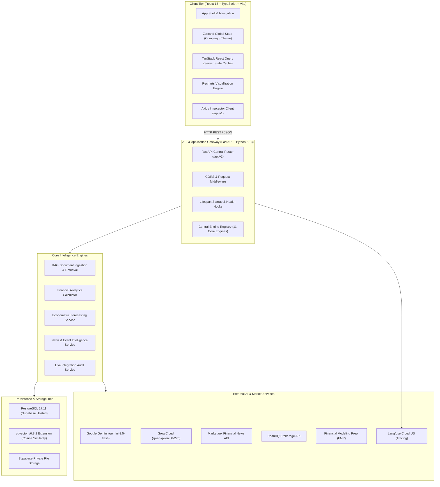
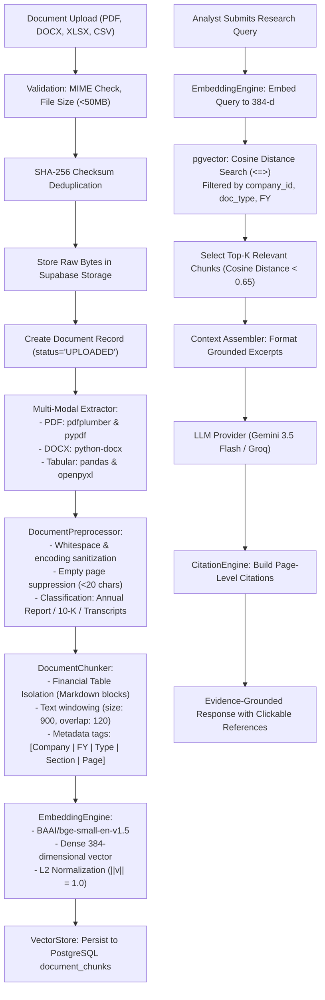
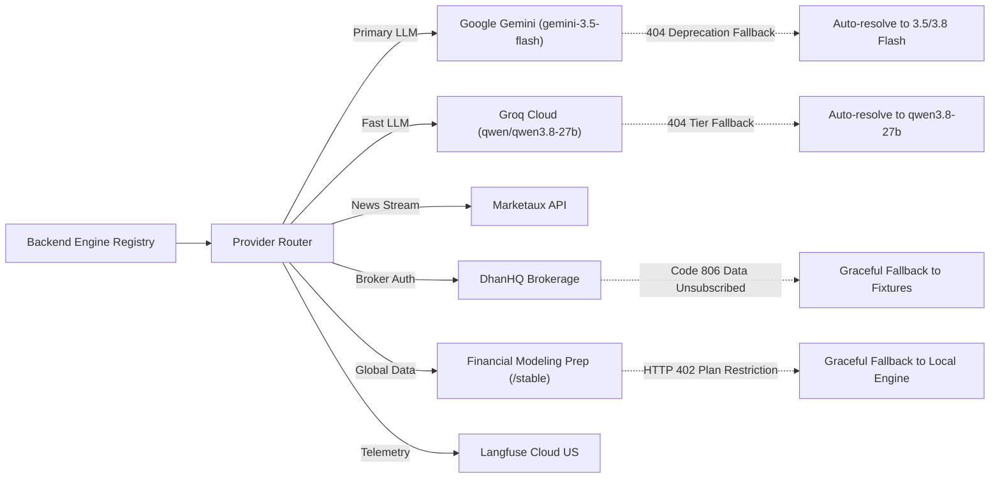

# EquiLens AI – Comprehensive System Architecture Specification

## 1. System Vision & Design Philosophy

EquiLens AI is an institutional-grade financial intelligence research terminal combining:
1. **Retrieval-Augmented Generation (RAG):** Document intelligence with verifiable page-level citations back to authentic corporate filings.
2. **Deterministic Financial Analytics:** Zero-tolerance mathematical computation for fundamental ratios (DuPont ROE, ROCE, FCF, Margins).
3. **Econometric Performance Forecasting:** Multi-period scenario bands (Bull, Base, Bear) backed by walk-forward cross-validation and parametric confidence intervals.
4. **News & Corporate Deals Intelligence:** Collision-safe entity matching, event classification, and sentiment tone scoring for Indian equities (NSE/BSE).
5. **Central Engine Registry:** Dynamic health introspection, graceful degradation, and provider failover.

---

## 2. High-Level System Architecture

---

## 3. Frontend Architecture

### 3.1 Technology Stack & Directory Structure
* **Framework:** React 18.3 with TypeScript (strict type checking enabled).
* **Build System:** Vite 5.4 generating optimized production chunks in ~1.2s.
* **Styling:** Tailwind CSS 3.4 featuring a specialized financial dark palette (`slate-900`, `slate-950`, `blue-500`, `emerald-500`, `rose-500`, `amber-500`).
* **Routing:** `react-router-dom` v6 with layout nesting:
  * `/` -> `OverviewPage`
  * `/explore` -> `ExploreCompaniesPage`
  * `/company/:symbol` -> `CompanyDetailPage`
  * `/documents` -> `DocumentIntelligencePage`
  * `/research` -> `AIResearchPage`
  * `/forecasts` -> `ForecastsPage`
  * `/news` -> `NewsIntelligencePage`
  * `/corporate-actions` -> `CorporateActionsPage`
  * `/market-events` -> `MarketEventsPage`
  * `/compare` -> `PeerComparisonPage`
  * `/watchlist` -> `WatchlistPage`
  * `/reports` -> `ResearchReportsPage`
  * `/settings` -> `SettingsPage`

### 3.2 State Management & Data Fetching
* **Zustand Stores:**
  * `useCompanyStore`: Tracks the currently selected equity, symbol search string, active financial year, and document filters.
  * `useThemeStore`: Controls dark/light UI theme toggling.
* **TanStack React Query v5:**
  * Queries configured with `refetchOnWindowFocus: false` and `retry: 1` to optimize network traffic.
  * Cache invalidation triggered automatically upon document upload or forecast generation.
* **Axios API Client:** Centralized instance in `src/services/api.ts` with global response interceptors surfacing typed API error messages.

---

## 4. Backend Application Architecture

### 4.1 Dependency Injection & ASGI Runtime
* **FastAPI Lifespan Management:** Database schemas verified, initial market seed data populated, and engine registry initialized during application startup in `app/main.py`.
* **Database Session Dependency:** Scoped SQLAlchemy sessions yielded via `get_db()` with automated closure in `finally` blocks.
* **Modular Routing:** 10 endpoint controllers mounted cleanly under `app/api/v1/router.py`:
  * `health.py`: Application health, engine health, and live API integration audits.
  * `companies.py`: Company profiles, symbol search, valuation multiples.
  * `documents.py`: Document upload, status polling, processing triggers.
  * `research.py`: Grounded conversational RAG, session management.
  * `news.py`: Marketaux synchronization, news feeds, entity filtering.
  * `financials.py`: Three-statement financials, deterministic ratios, peer matrices.
  * `corporate_actions.py`: Dividends, stock splits, bonus issues.
  * `market_events.py`: Major commercial contracts and M&A tracking.
  * `forecasts.py`: Scenario generation, out-of-sample backtesting metrics.
  * `watchlist.py`: Analyst equity tracking and price target notes.

---

## 5. RAG & Document Intelligence Pipeline

---

## 6. Financial Analytics & Forecasting Architecture

### 6.1 Deterministic Accounting Calculator
* Strictly separates mathematical computation from generative language models.
* `FinancialCalculator` implements zero-denominator safeguards across all ratios:
  * YoY Revenue Growth: $(\frac{\text{Value}_t - \text{Value}_{t-1}}{|\text{Value}_{t-1}|}) \times 100$
  * EBITDA & PAT Margins: $(\frac{\text{Metric}}{\text{Revenue}}) \times 100$
  * DuPont ROE: $(\frac{\text{Net Profit}}{\text{Equity}}) \times 100$
  * ROCE: $(\frac{\text{EBIT}}{\text{Total Assets} - \text{Current Liabilities}}) \times 100$
  * Free Cash Flow: $\text{Operating Cash Flow} - |\text{CapEx}|$
  * Solvency: $\text{Debt-to-Equity} = \frac{\text{Total Debt}}{\text{Equity}}$, $\text{Current Ratio} = \frac{\text{Current Assets}}{\text{Current Liabilities}}$

### 6.2 Econometric Forecasting Engine
* Combines autoregressive modeling $AR(p)$ with linear ordinary least squares (OLS) time-series trends.
* Generates 3 discrete operational trajectories:
  * **Base Case:** Historical econometric trajectory.
  * **Bullish Scenario:** $+15\%$ to $+20\%$ expansion band.
  * **Bearish Scenario:** $-15\%$ contraction band.
* Evaluates out-of-sample forecast accuracy using chronological walk-forward cross-validation (MAE, RMSE, MAPE, Directional Accuracy).
* Attaches mandatory regulatory compliance disclaimers to all outputs.

---

## 7. News & Corporate Deals Intelligence Architecture

* **Multi-Source Ingestion:** Marketaux REST API integration with fallback to high-fidelity Indian equity fixtures.
* **Collision-Safe Entity Matching (`NewsEntityMatcher`):** Employs word-boundary regular expressions (`\bSYMBOL\b`) to prevent false positives on common words (e.g. matching "IT" to L&T Infotech or "reliance" in prose).
* **Taxonomy Classification (`NewsEventClassifier`):** Categorizes articles into `Earnings`, `Contracts`, `M&A`, `Regulatory`, `Dividends`, and `Partnerships`.
* **Tone Sentiment Scoring (`NewsSentimentAnalyzer`):** Lexicon-weighted tone scoring between `-1.0` (Extremely Bearish) and `+1.0` (Extremely Bullish).

---

## 8. External API Communication & Resilient Failover

---

## 9. Security & Access Architecture

* **Authentication:** JWT tokens signed via HMAC-SHA256 (`HS256`) with configurable expiration.
* **Database Isolation:** Supabase PostgreSQL with SSL encryption and Row Level Security (RLS) isolating documents and chat sessions by `user_id`.
* **Prompt Injection Defense:** Strict XML delimitation between system instructions and untrusted document chunks.
* **Input Validation:** Pydantic v2 strict schema enforcement and file extension/MIME whitelisting.

