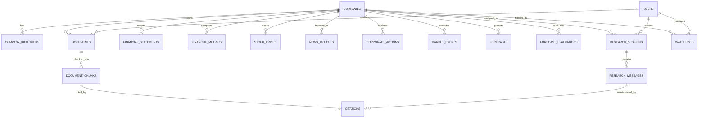

# EquiLens AI – Database Architecture & Schema Specification

**Target Database:** PostgreSQL 17.11 with `pgvector` v0.8.2  
**Hosting Provider:** Supabase Cloud (`db.ceedxgiuppobapaypxnb.supabase.co:5432`)  
**ORM Framework:** SQLAlchemy 2.0 (Declarative Base)  
**Migration Tool:** Alembic (Current Migration Revision: `b232c19f2190`)  
**Total Tables:** 18 Relational & Vector Tables

---

## 1. Entity-Relationship Overview

---

## 2. Table Specifications & Column Dictionaries

### 2.1 Table: `users`
Stores analyst credentials, authentication profiles, and system access roles.
* **Primary Key:** `id` (UUID, Default `gen_random_uuid()`)
* **Columns:**
  * `id` (UUID, PK)
  * `email` (VARCHAR(255), UNIQUE, NOT NULL): Analyst login email.
  * `hashed_password` (VARCHAR(255), NULLABLE): PBKDF2/Bcrypt hash.
  * `full_name` (VARCHAR(255), NULLABLE): Display name.
  * `role` (VARCHAR(50), DEFAULT `'analyst'`): Role-based access tier (`admin`, `analyst`, `viewer`).
  * `is_active` (BOOLEAN, DEFAULT `TRUE`): Soft-delete and suspension status.
  * `created_at` (TIMESTAMPTZ, DEFAULT `utc_now()`)
  * `updated_at` (TIMESTAMPTZ, DEFAULT `utc_now()`)

---

### 2.2 Table: `companies`
Core master table holding corporate identity, valuation metrics, and market statistics for Indian and global equities.
* **Primary Key:** `id` (UUID, Default `gen_random_uuid()`)
* **Indexes:** `idx_companies_symbol` (`symbol`), `idx_companies_sector` (`sector`), `idx_companies_exchange` (`exchange`).
* **Columns:**
  * `id` (UUID, PK)
  * `symbol` (VARCHAR(50), UNIQUE, NOT NULL): Exchange ticker (e.g., `RELIANCE`, `TCS`).
  * `name` (VARCHAR(255), NOT NULL): Full legal corporate name.
  * `exchange` (VARCHAR(20), DEFAULT `'NSE'`): Primary trading exchange (`NSE`, `BSE`, `NASDAQ`).
  * `isin` (VARCHAR(50), NULLABLE): International Securities Identification Number.
  * `sector` (VARCHAR(100), NULLABLE): Macro sector (e.g. `Energy`, `Information Technology`).
  * `industry` (VARCHAR(100), NULLABLE): Sub-industry classification.
  * `market_cap` (NUMERIC(18, 2), NULLABLE): Market capitalization in INR Crores.
  * `current_price` (NUMERIC(12, 2), NULLABLE): Last traded price (INR).
  * `day_change` (NUMERIC(10, 2), NULLABLE): Absolute daily price movement.
  * `day_change_percent` (NUMERIC(8, 2), NULLABLE): Daily percentage movement.
  * `pe_ratio` (NUMERIC(10, 2), NULLABLE): Price-to-Earnings ratio.
  * `pb_ratio` (NUMERIC(10, 2), NULLABLE): Price-to-Book ratio.
  * `roe` (NUMERIC(8, 2), NULLABLE): Return on Equity percentage.
  * `roce` (NUMERIC(8, 2), NULLABLE): Return on Capital Employed percentage.
  * `dividend_yield` (NUMERIC(8, 2), NULLABLE): Dividend yield percentage.
  * `week_52_high` (NUMERIC(12, 2), NULLABLE): 52-week high price.
  * `week_52_low` (NUMERIC(12, 2), NULLABLE): 52-week low price.
  * `currency` (VARCHAR(10), DEFAULT `'INR'`): Reporting currency.
  * `description` (TEXT, NULLABLE): Company business summary.
  * `website` (VARCHAR(255), NULLABLE): Corporate website URL.
  * `is_active` (BOOLEAN, DEFAULT `TRUE`)
  * `created_at` (TIMESTAMPTZ)
  * `updated_at` (TIMESTAMPTZ)

---

### 2.3 Table: `company_identifiers`
Alternative exchange symbols and third-party security mapping identifiers.
* **Primary Key:** `id` (UUID)
* **Foreign Key:** `company_id` -> `companies(id)` ON DELETE CASCADE.
* **Indexes:** `idx_comp_ident` (`identifier_type`, `identifier_value`).
* **Columns:**
  * `id` (UUID, PK)
  * `company_id` (UUID, FK, NOT NULL)
  * `identifier_type` (VARCHAR(50), NOT NULL): `BSE_CODE`, `CIN`, `BLOOMBERG_TICKER`, `RIC`.
  * `identifier_value` (VARCHAR(100), NOT NULL): e.g. `500325` for Reliance on BSE.
  * `created_at` (TIMESTAMPTZ)

---

### 2.4 Table: `documents`
Uploaded regulatory filings, reports, transcripts, and financial spreadsheets.
* **Primary Key:** `id` (UUID)
* **Foreign Keys:** `company_id` -> `companies(id)` ON DELETE CASCADE; `user_id` -> `users(id)` ON DELETE SET NULL.
* **Indexes:** `idx_docs_company_fy` (`company_id`, `financial_year`).
* **Columns:**
  * `id` (UUID, PK)
  * `user_id` (UUID, FK, NULLABLE)
  * `company_id` (UUID, FK, NOT NULL)
  * `title` (VARCHAR(255), NOT NULL): Document title.
  * `filename` (VARCHAR(255), NOT NULL): Storage filename.
  * `file_path` (VARCHAR(512), NOT NULL): Supabase bucket or local disk path.
  * `file_size_bytes` (INTEGER, NOT NULL): File size in bytes.
  * `mime_type` (VARCHAR(100), NOT NULL): `application/pdf`, `application/vnd.openxmlformats-officedocument.wordprocessingml.document`, etc.
  * `file_hash` (VARCHAR(64), NULLABLE): SHA-256 checksum for deduplication.
  * `financial_year` (VARCHAR(20), NULLABLE): e.g. `FY24`, `FY25`.
  * `document_type` (VARCHAR(50), NOT NULL): `Annual Report`, `Quarterly Result`, `Earnings Call`, `Presentation`.
  * `status` (VARCHAR(30), DEFAULT `'UPLOADED'`): `UPLOADED`, `EXTRACTED`, `PROCESSING`, `PROCESSED`, `FAILED`.
  * `error_message` (TEXT, NULLABLE): Failure diagnostics if processing failed.
  * `total_pages` (INTEGER, DEFAULT `0`): Page count.
  * `total_chunks` (INTEGER, DEFAULT `0`): Number of derived vector chunks.
  * `metadata_json` (JSONB, DEFAULT `'{}'::jsonb`): Additional arbitrary metadata.
  * `created_at` (TIMESTAMPTZ)
  * `updated_at` (TIMESTAMPTZ)

---

### 2.5 Table: `document_chunks`
Extracted text and tabular passages with 384-dimensional dense vector embeddings.
* **Primary Key:** `id` (UUID)
* **Foreign Keys:** `document_id` -> `documents(id)` ON DELETE CASCADE; `company_id` -> `companies(id)` ON DELETE CASCADE.
* **Indexes:** `idx_chunks_company_page` (`company_id`, `page_number`).
* **Vector Index:** Cosine distance index on `embedding` (`<=>` operator).
* **Columns:**
  * `id` (UUID, PK)
  * `document_id` (UUID, FK, NOT NULL)
  * `company_id` (UUID, FK, NOT NULL)
  * `chunk_index` (INTEGER, NOT NULL): Sequential index within document.
  * `content` (TEXT, NOT NULL): Raw text or formatted Markdown table.
  * `clean_text` (TEXT, NULLABLE): Sanitized text used for embedding generation.
  * `section` (VARCHAR(100), NULLABLE): Document section title (e.g. `MD&A`, `Auditor's Report`).
  * `page_number` (INTEGER, NULLABLE): Exact page number in original document.
  * `token_count` (INTEGER, DEFAULT `0`): Approximate token count.
  * `embedding` (`vector(384)`, NULLABLE): 384-dimensional dense float vector from `BAAI/bge-small-en-v1.5`.
  * `metadata_json` (JSONB, DEFAULT `'{}'::jsonb`): Preserves table headers, periods, units.
  * `created_at` (TIMESTAMPTZ)

---

### 2.6 Table: `financial_statements`
Structured primary financial statements (P&L, Balance Sheet, Cash Flow).
* **Primary Key:** `id` (UUID)
* **Foreign Key:** `company_id` -> `companies(id)` ON DELETE CASCADE.
* **Columns:**
  * `id` (UUID, PK)
  * `company_id` (UUID, FK, NOT NULL)
  * `statement_type` (VARCHAR(50), NOT NULL): `INCOME_STATEMENT`, `BALANCE_SHEET`, `CASH_FLOW`.
  * `period_type` (VARCHAR(20), NOT NULL): `annual`, `quarterly`.
  * `financial_year` (VARCHAR(20), NOT NULL): e.g. `FY24`.
  * `quarter` (VARCHAR(10), NULLABLE): `Q1`, `Q2`, `Q3`, `Q4`.
  * `period_end_date` (DATE, NOT NULL): Statement closing date.
  * `is_consolidated` (BOOLEAN, DEFAULT `TRUE`): Standalone vs Consolidated.
  * `currency` (VARCHAR(10), DEFAULT `'INR'`): Reporting currency.
  * `unit` (VARCHAR(20), DEFAULT `'INR_CRORES'`): Unit multiplier.
  * `raw_data` (JSONB, DEFAULT `'{}'::jsonb`): Full JSON key-value line items.
  * `is_audited` (BOOLEAN, DEFAULT `TRUE`)
  * `source` (VARCHAR(100), DEFAULT `'NSE_FILING'`)
  * `created_at` (TIMESTAMPTZ)

---

### 2.7 Table: `financial_metrics`
Normalized individual financial line items and computed fundamental metrics.
* **Primary Key:** `id` (UUID)
* **Foreign Key:** `company_id` -> `companies(id)` ON DELETE CASCADE.
* **Indexes:** `idx_fin_metrics_lookup` (`company_id`, `metric_name`, `financial_year`).
* **Columns:**
  * `id` (UUID, PK)
  * `company_id` (UUID, FK, NOT NULL)
  * `metric_name` (VARCHAR(100), NOT NULL): `revenue`, `ebitda`, `net_profit`, `total_debt`, `free_cash_flow`.
  * `period_type` (VARCHAR(20), NOT NULL): `annual` or `quarterly`.
  * `financial_year` (VARCHAR(20), NOT NULL): e.g. `FY24`.
  * `quarter` (VARCHAR(10), NULLABLE)
  * `period_end_date` (DATE, NOT NULL)
  * `value` (NUMERIC(18, 4), NOT NULL): Numerical value in INR Crores.
  * `currency` (VARCHAR(10), DEFAULT `'INR'`)
  * `unit` (VARCHAR(20), DEFAULT `'INR_CRORES'`)
  * `is_audited` (BOOLEAN, DEFAULT `TRUE`)
  * `created_at` (TIMESTAMPTZ)

---

### 2.8 Table: `stock_prices`
Historical daily OHLCV candlestick records and technical indicators.
* **Primary Key:** `id` (UUID)
* **Foreign Key:** `company_id` -> `companies(id)` ON DELETE CASCADE.
* **Indexes:** `idx_stock_prices_date` (`company_id`, `price_date`).
* **Columns:**
  * `id` (UUID, PK)
  * `company_id` (UUID, FK, NOT NULL)
  * `price_date` (DATE, NOT NULL): Trading date.
  * `open_price` (NUMERIC(12, 2), NOT NULL)
  * `high_price` (NUMERIC(12, 2), NOT NULL)
  * `low_price` (NUMERIC(12, 2), NOT NULL)
  * `close_price` (NUMERIC(12, 2), NOT NULL)
  * `volume` (BIGINT, DEFAULT `0`): Shares traded.
  * `sma_50` (NUMERIC(12, 2), NULLABLE): 50-day moving average.
  * `sma_200` (NUMERIC(12, 2), NULLABLE): 200-day moving average.
  * `created_at` (TIMESTAMPTZ)

---

### 2.9 Table: `news_articles`
Financial news articles, corporate announcements, and tone sentiment scores.
* **Primary Key:** `id` (UUID)
* **Foreign Key:** `company_id` -> `companies(id)` ON DELETE SET NULL.
* **Indexes:** `idx_news_published` (`published_at`), `idx_news_sentiment` (`sentiment_label`).
* **Columns:**
  * `id` (UUID, PK)
  * `company_id` (UUID, FK, NULLABLE)
  * `external_id` (VARCHAR(255), UNIQUE, NULLABLE): Marketaux UUID or hash.
  * `title` (VARCHAR(500), NOT NULL): Article headline.
  * `description` (TEXT, NULLABLE): Lead paragraph.
  * `content` (TEXT, NULLABLE): Full article body.
  * `url` (VARCHAR(1000), NOT NULL): Canonical web link.
  * `source_name` (VARCHAR(100), NULLABLE): Publisher (e.g. `Economic Times`, `Moneycontrol`).
  * `published_at` (TIMESTAMPTZ, NOT NULL): Publication timestamp.
  * `category` (VARCHAR(50), DEFAULT `'General'`): `Earnings`, `Contracts`, `M&A`, `Regulatory`, `Dividends`.
  * `sentiment_label` (VARCHAR(20), DEFAULT `'Neutral'`): `Bullish`, `Bearish`, `Neutral`.
  * `sentiment_score` (NUMERIC(5, 4), NULLABLE): Score from `-1.0000` to `+1.0000`.
  * `ai_summary` (TEXT, NULLABLE): AI executive takeaway.
  * `financial_impact` (TEXT, NULLABLE): Assessment of revenue/margin impact.
  * `is_duplicate` (BOOLEAN, DEFAULT `FALSE`)
  * `created_at` (TIMESTAMPTZ)

---

### 2.10 Table: `corporate_actions`
Official dividend announcements, stock splits, bonus issues, and rights offerings.
* **Primary Key:** `id` (UUID)
* **Foreign Key:** `company_id` -> `companies(id)` ON DELETE CASCADE.
* **Columns:**
  * `id` (UUID, PK)
  * `company_id` (UUID, FK, NOT NULL)
  * `action_type` (VARCHAR(50), NOT NULL): `Dividend`, `Stock Split`, `Bonus Issue`, `Buyback`.
  * `details` (TEXT, NOT NULL): Descriptive terms (e.g. `Interim Dividend ₹10.00 per share`).
  * `ratio_or_amount` (VARCHAR(50), NULLABLE): e.g. `1:1`, `₹10.00`.
  * `announcement_date` (DATE, NULLABLE)
  * `ex_date` (DATE, NULLABLE)
  * `record_date` (DATE, NULLABLE)
  * `payment_date` (DATE, NULLABLE)
  * `status` (VARCHAR(30), DEFAULT `'Announced'`)
  * `source` (VARCHAR(100), DEFAULT `'NSE_EXCHANGE'`)
  * `created_at` (TIMESTAMPTZ)

---

### 2.11 Table: `market_events`
Major commercial contracts, acquisitions, partnerships, and joint ventures.
* **Primary Key:** `id` (UUID)
* **Foreign Key:** `company_id` -> `companies(id)` ON DELETE CASCADE.
* **Columns:**
  * `id` (UUID, PK)
  * `company_id` (UUID, FK, NOT NULL)
  * `event_type` (VARCHAR(50), NOT NULL): `Acquisition`, `Major Contract`, `Joint Venture`, `Asset Sale`.
  * `title` (VARCHAR(255), NOT NULL): Event headline.
  * `description` (TEXT, NOT NULL): Detailed terms.
  * `deal_value` (NUMERIC(18, 2), NULLABLE): Monetary value in INR Crores.
  * `deal_currency` (VARCHAR(10), DEFAULT `'INR'`)
  * `counterparty` (VARCHAR(255), NULLABLE): Other contracting entity.
  * `strategic_implications` (TEXT, NULLABLE): Impact on corporate capabilities.
  * `disclosed_date` (DATE, NOT NULL)
  * `source_url` (VARCHAR(500), NULLABLE)
  * `created_at` (TIMESTAMPTZ)

---

### 2.12 Table: `forecasts`
Multi-scenario econometric projections for key financial metrics.
* **Primary Key:** `id` (UUID)
* **Foreign Key:** `company_id` -> `companies(id)` ON DELETE CASCADE.
* **Columns:**
  * `id` (UUID, PK)
  * `company_id` (UUID, FK, NOT NULL)
  * `metric_name` (VARCHAR(50), NOT NULL): `revenue`, `net_profit`, `ebitda`, `eps`.
  * `model_type` (VARCHAR(50), NOT NULL): `Baseline AR(p) + OLS`.
  * `model_version` (VARCHAR(20), DEFAULT `'1.0'`)
  * `forecast_period` (VARCHAR(20), NOT NULL): e.g. `FY25`, `FY26`.
  * `target_date` (DATE, NOT NULL): Forecast terminal date.
  * `predicted_value` (NUMERIC(18, 4), NOT NULL): Projected point estimate.
  * `scenario` (VARCHAR(20), DEFAULT `'Base'`): `Base`, `Bull`, `Bear`.
  * `confidence_interval_lower` (NUMERIC(18, 4), NULLABLE): Lower bound.
  * `confidence_interval_upper` (NUMERIC(18, 4), NULLABLE): Upper bound.
  * `confidence_level` (NUMERIC(4, 2), DEFAULT `0.95`): 0.80 or 0.95.
  * `assumptions` (JSONB, DEFAULT `'{}'::jsonb`)
  * `created_at` (TIMESTAMPTZ)

---

### 2.13 Table: `forecast_evaluations`
Out-of-sample backtest metrics validating forecast model accuracy.
* **Primary Key:** `id` (UUID)
* **Foreign Key:** `company_id` -> `companies(id)` ON DELETE CASCADE.
* **Columns:**
  * `id` (UUID, PK)
  * `company_id` (UUID, FK, NOT NULL)
  * `model_type` (VARCHAR(50), NOT NULL)
  * `metric_name` (VARCHAR(50), NOT NULL)
  * `evaluation_date` (TIMESTAMPTZ)
  * `train_start_date` (DATE, NOT NULL)
  * `train_end_date` (DATE, NOT NULL)
  * `test_start_date` (DATE, NOT NULL)
  * `test_end_date` (DATE, NOT NULL)
  * `mae` (NUMERIC(12, 4), NOT NULL): Mean Absolute Error.
  * `rmse` (NUMERIC(12, 4), NOT NULL): Root Mean Squared Error.
  * `mape` (NUMERIC(8, 4), NULLABLE): Mean Absolute Percentage Error.
  * `directional_accuracy` (NUMERIC(6, 2), NULLABLE): Percentage correct direction.
  * `sample_count` (INTEGER, DEFAULT `0`)
  * `features_used` (JSONB, DEFAULT `'[]'::jsonb`)
  * `created_at` (TIMESTAMPTZ)

---

### 2.14 Table: `research_sessions`
Conversational equity research chat sessions.
* **Primary Key:** `id` (UUID)
* **Foreign Keys:** `user_id` -> `users(id)` ON DELETE SET NULL; `company_id` -> `companies(id)` ON DELETE SET NULL.
* **Columns:**
  * `id` (UUID, PK)
  * `user_id` (UUID, FK, NULLABLE)
  * `company_id` (UUID, FK, NULLABLE)
  * `title` (VARCHAR(255), NOT NULL): Session heading.
  * `is_active` (BOOLEAN, DEFAULT `TRUE`)
  * `created_at` (TIMESTAMPTZ)
  * `updated_at` (TIMESTAMPTZ)

---

### 2.15 Table: `research_messages`
Individual conversational turns in a research session.
* **Primary Key:** `id` (UUID)
* **Foreign Key:** `session_id` -> `research_sessions(id)` ON DELETE CASCADE.
* **Columns:**
  * `id` (UUID, PK)
  * `session_id` (UUID, FK, NOT NULL)
  * `role` (VARCHAR(20), NOT NULL): `user` or `assistant`.
  * `content` (TEXT, NOT NULL): Message body.
  * `message_type` (VARCHAR(30), DEFAULT `'synthesis'`): `fact_grounded`, `calculation`, `synthesis`.
  * `token_count` (INTEGER, DEFAULT `0`)
  * `created_at` (TIMESTAMPTZ)

---

### 2.16 Table: `citations`
Exact page-level document citations substantiating assistant claims.
* **Primary Key:** `id` (UUID)
* **Foreign Keys:** `message_id` -> `research_messages(id)` ON DELETE CASCADE; `document_id` -> `documents(id)` ON DELETE CASCADE; `document_chunk_id` -> `document_chunks(id)` ON DELETE SET NULL.
* **Columns:**
  * `id` (UUID, PK)
  * `message_id` (UUID, FK, NOT NULL)
  * `document_id` (UUID, FK, NOT NULL)
  * `document_chunk_id` (UUID, FK, NULLABLE)
  * `chunk_index` (INTEGER, NULLABLE)
  * `page_number` (INTEGER, NULLABLE): Exact page number in original filing.
  * `section` (VARCHAR(100), NULLABLE): Document section title.
  * `excerpt` (TEXT, NOT NULL): Quoted supporting passage.
  * `source_url` (VARCHAR(500), NULLABLE)
  * `confidence_score` (NUMERIC(5, 4), DEFAULT `0.9500`)
  * `created_at` (TIMESTAMPTZ)

---

### 2.17 Table: `watchlists`
Analyst-tracked equities with custom price targets and notes.
* **Primary Key:** `id` (UUID)
* **Foreign Keys:** `user_id` -> `users(id)` ON DELETE CASCADE; `company_id` -> `companies(id)` ON DELETE CASCADE.
* **Constraints:** `CONSTRAINT uq_user_company_watch UNIQUE (user_id, company_id)`.
* **Columns:**
  * `id` (UUID, PK)
  * `user_id` (UUID, FK, NOT NULL)
  * `company_id` (UUID, FK, NOT NULL)
  * `target_price` (NUMERIC(12, 2), NULLABLE)
  * `alert_threshold_percent` (NUMERIC(5, 2), NULLABLE)
  * `notes` (VARCHAR(500), NULLABLE)
  * `created_at` (TIMESTAMPTZ)

---

### 2.18 Table: `engine_status_logs`
Historical log of central engine registry transitions and external service health.
* **Primary Key:** `id` (UUID)
* **Columns:**
  * `id` (UUID, PK)
  * `engine_name` (VARCHAR(100), NOT NULL): e.g. `database`, `pgvector`, `gemini`, `marketaux`.
  * `state` (VARCHAR(50), NOT NULL): `Ready`, `Degraded`, `Disabled`, `Failed`.
  * `provider` (VARCHAR(100), NULLABLE)
  * `details` (TEXT, NULLABLE)
  * `latency_ms` (NUMERIC(10, 2), NULLABLE)
  * `created_at` (TIMESTAMPTZ)

