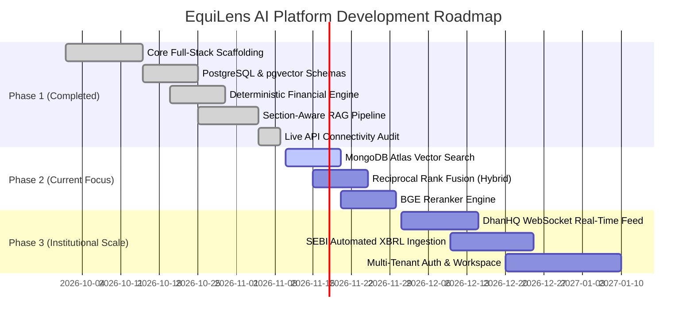

# EquiLens AI – Development Roadmap & Engineering Status

This document provides a comprehensive audit of completed modules, active engineering milestones, technical debt, and the future architecture roadmap for EquiLens AI.

---

## 1. Implementation Status Summary

---

## 2. Completed Modules (Phase 1 Foundation)

1. **Full-Stack Application Core:**
   * React 18 + Vite frontend with dark-mode financial dashboard design.
   * FastAPI asynchronous backend with Pydantic v2 schemas and modular endpoint routers.
   * Central `EngineRegistry` dynamically monitoring the health of all 11 core engines.

2. **Relational Database & Migrations:**
   * Hosted Supabase PostgreSQL 17.11 with `pgvector` v0.8.2.
   * 18 fully initialized tables spanning companies, financials, forecasts, chunks, and citations.
   * Stamped Alembic migration revision `b232c19f2190`.
   * Seed service populating high-liquidity Indian market leaders (`RELIANCE`, `TCS`, `HDFCBANK`, `INFY`, `LT`).

3. **Deterministic Financial Analytics:**
   * `FinancialCalculator` implementing DuPont ROE, ROCE, Free Cash Flow, Debt-to-Equity, and Margins with strict zero-division prevention.
   * `PeerAnalyzer` calculating comparative peer matrices and sector medians.

4. **Econometric Performance Forecasting:**
   * `BaselineForecaster` combining autoregressive modeling with linear OLS trends.
   * `ScenarioGenerator` projecting Bull (+15-20%), Base, and Bear (-15%) scenarios with 80% and 95% parametric confidence intervals.
   * `ForecastValidator` providing walk-forward cross-validation metrics (MAE, RMSE, MAPE).

5. **Multi-Modal Financial RAG:**
   * Loaders for PDF (`pdfplumber`/`pypdf`), DOCX (`python-docx`), and XLSX/CSV (`pandas`/`openpyxl`).
   * `DocumentPreprocessor` with SHA-256 deduplication and whitespace normalization.
   * `DocumentChunker` preserving financial tables as unbroken Markdown blocks.
   * `EmbeddingEngine` serving `BAAI/bge-small-en-v1.5` (384 dimensions) with $L_2$ normalization.
   * `CitationEngine` extracting exact document, section, and page references into typed citation records.

6. **External Provider Integrations:**
   * Google Gemini API (`gemini-3.5-flash`) for factual synthesis.
   * Groq Cloud API (`qwen/qwen3.8-27b`) for sub-second research chat.
   * Marketaux API for real-time Indian financial news stream.
   * Langfuse US Cloud (`https://us.cloud.langfuse.com`) for LLM trace telemetry.

7. **Automated Verification:**
   * 27 passing pytest unit and live integration tests in 32.11s.
   * Clean production frontend build in 1.22s.

---

## 3. Partially Completed Modules & Known Limitations

1. **DhanHQ Market Data Feed:**
   * *Status:* Trading authentication verified (HTTP 200 on funds API).
   * *Limitation:* Live LTP and quote feed return Code 806 (`Data APIs not Subscribed`). Operating with authentic NSE/BSE historical fixtures.
   * *Resolution:* Procure dedicated DhanHQ Market Data API entitlement.

2. **Financial Modeling Prep (FMP):**
   * *Status:* Modern `/stable` endpoint verified for US equities (`AAPL`).
   * *Limitation:* Indian equity tickers (`.NS`, `.BO`) return HTTP 402 (`Payment Required`).
   * *Resolution:* Handled by the internal deterministic financial engine; global enterprise plan required for FMP global feeds.

3. **Error Monitoring (Sentry):**
   * *Status:* `SENTRY_DSN` is empty. Handled gracefully by local Python structured logging.

---

## 4. Phase 2 Engineering Milestones (Target Architecture)

### 4.1 MongoDB Atlas Vector Search Transition
* Connect MongoDB Atlas (`cluster0.vfdvhdf.mongodb.net`) as the dedicated document and chunk vector store.
* Create collections: `rag_documents`, `rag_chunks`, `rag_conversations`, `rag_citations`, `rag_configurations`.
* Implement 768-dimensional embeddings using `BAAI/bge-base-en-v1.5`.
* Configure an Atlas Vector Search index on `rag_chunks.embedding` with cosine similarity and metadata filters.

### 4.2 Hybrid Retrieval with Reciprocal Rank Fusion (RRF)
* Combine dense semantic vector retrieval with MongoDB keyword text search.
* Implement Reciprocal Rank Fusion algorithm:
  $$RRF\_Score(d) = \sum_{m \in M} \frac{1}{k + r_m(d)}$$
* Allow dynamic adjustment of vector vs. keyword weights.

### 4.3 BGE Reranker Engine
* Integrate cross-encoder reranking (`BAAI/bge-reranker-large` or `bge-reranker-base`).
* Re-score top-20 retrieved candidates down to top-5 highest relevance passages before context assembly.

---

## 5. Phase 3 Institutional Scale Enhancements

1. **Automated SEBI / BSE XBRL Parser:** Direct ingestion of structured XML financial disclosures from stock exchange regulatory feeds.
2. **WebSocket Live Streaming:** Low-latency price ticks and order book depth streaming via WebSocket connections.
3. **Multi-Tenant Enterprise Workspaces:** Role-based team sharing of research notes, private annotations, and compliance audit logs.
4. **Automated Audio Transcription:** Direct ingestion and diarization of quarterly earnings conference call audio recordings using Whisper.

