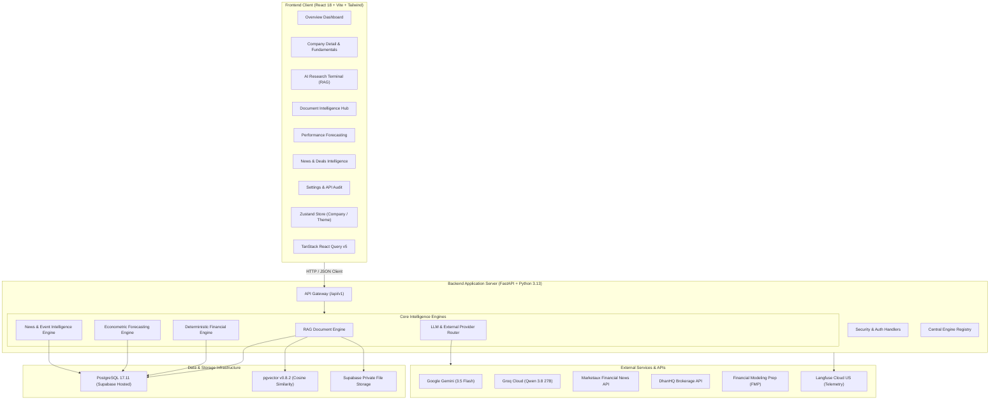

# EquiLens AI – Technical Documentation Index & Project Overview

> **Tagline:** *See Beyond the Stock Price.*  
> **Target Market:** Indian Equity Markets (NSE & BSE) with scalable architecture for Global Equities.  
> **Platform Version:** 1.0.0-rc1  
> **Primary Technology Stack:** React 18, Vite, Tailwind CSS, FastAPI, PostgreSQL 17, pgvector 0.8.2, Sentence-Transformers, Google Gemini, Groq, Langfuse.

---

## 1. Executive Overview & Problem Statement

### 1.1 The Problem
Institutional equity research analysts and serious retail investors face a severe structural friction:
1. **Fragmented Workflows:** Fundamental analysis, document review (annual reports, quarterly earnings transcripts), news monitoring, and quantitative forecasting exist in disjointed silos.
2. **Hallucination in LLM Finance:** Generic AI chatbots (ChatGPT, Claude) lack deterministic grounding, regularly hallucinating accounting metrics, fabricating mathematical calculations, and inventing non-existent document citations.
3. **Static Screeners:** Existing equity screeners display historical metrics without contextualizing management commentary, strategic capital allocation shifts, or corporate event risks.

### 1.2 EquiLens AI Solution
EquiLens AI bridges quantitative financial analytics and unstructured document intelligence into a unified institutional equity research terminal:
* **Deterministic Accounting:** Zero-tolerance mathematical computation for accounting ratios, DuPont decomposition, and cash flow analysis.
* **Evidence-Grounded RAG:** Retrieval-Augmented Generation enforcing strict page-level and section-level citations back to authentic company regulatory filings.
* **Statistical Performance Forecasting:** Multi-scenario econometric projections (Bull, Base, Bear) backed by walk-forward cross-validation and parametric confidence intervals.
* **Corporate Actions & News Intelligence:** Real-time event extraction, tone sentiment analysis, and collision-safe entity matching for NSE and BSE equities.

---

## 2. Platform Architecture Overview



---

## 3. Technology Stack Reference

| Tier | Component | Technology / Library | Specification / Version |
| :--- | :--- | :--- | :--- |
| **Frontend** | Framework | React | 18.3.1 (TypeScript, strict typing) |
| | Build Tool | Vite | 5.4.21 (Production build time: ~1.2s) |
| | Styling | Tailwind CSS | 3.4.19 (Dark-mode financial palette) |
| | Icons | Lucide React | 0.344.0 |
| | State Management | Zustand | 4.5.2 (Global company & theme stores) |
| | Server State | TanStack Query | 5.28.4 (Window focus disabled, retry: 1) |
| | Visualizations | Recharts | 2.12.2 (Area, Bar, Line scenario charts) |
| | HTTP Client | Axios | 1.6.7 (Global error interceptors) |
| **Backend** | Framework | FastAPI | 0.115.0+ (ASGI asynchronous server) |
| | Runtime | Python | 3.13.15 (macOS arm64 execution) |
| | Web Server | Uvicorn | 0.30.0+ |
| | Data Validation | Pydantic v2 | 2.9.0+ (Strict type contracts) |
| | Database ORM | SQLAlchemy | 2.0.35+ (Declarative 2.0 style) |
| | Migrations | Alembic | 1.13.2+ (Migration revision: `b232c19f2190`) |
| **AI & RAG** | Embeddings | Sentence-Transformers | `BAAI/bge-small-en-v1.5` (384-d, L2 normalized) |
| | Document Loaders | pdfplumber, pypdf | PDF text & table extraction |
| | Office Loaders | python-docx, openpyxl | Word documents, Excel spreadsheets |
| | LLM Providers | Google Gemini | `gemini-3.5-flash` (Primary synthesis) |
| | Fast LLM Provider | Groq API | `qwen/qwen3.8-27b` (Low-latency chat) |
| **Storage** | Primary RDBMS | PostgreSQL | 17.11 (Hosted on Supabase Cloud) |
| | Vector Engine | pgvector | 0.8.2 (Cosine similarity indexing `<=>`) |
| | Object Storage | Supabase Storage | Encrypted private bucket with RLS |
| **Monitoring** | Tracing & LLM Ops| Langfuse | `https://us.cloud.langfuse.com` (Trace telemetry) |
| | Structured Logging| Python Logging | Standardized timestamped audit output |

---

## 4. Current Implementation Status Matrix

The codebase has been verified through automated test suites (27/27 passed) and live empirical API probes:

| Module / Capability | Implementation Status | Implementation Verification |
| :--- | :--- | :--- |
| **Central Engine Registry** | **Implemented** | 11/11 engines actively tracked via `/api/v1/health/engines` |
| **PostgreSQL Database** | **Implemented** | 18 tables created, schemas verified on Supabase PG 17.11 |
| **Vector Similarity Store** | **Implemented** | `pgvector` v0.8.2 cosine similarity queries functional |
| **Document Ingestion** | **Implemented** | PDF, DOCX, XLSX, CSV parsers with SHA-256 deduplication |
| **Section-Aware Chunking** | **Implemented** | Table preservation, markdown formatting, metadata injection |
| **RAG Evidence Synthesis** | **Implemented** | Gemini 3.5 Flash / Groq integration with citation schema |
| **Financial Analytics** | **Implemented** | Deterministic formulas (DuPont, ROCE, FCF, Margins, D/E) |
| **Performance Forecasting** | **Implemented** | Baseline $AR(p)$, walk-forward cross-validation, Bull/Base/Bear |
| **News Intelligence** | **Implemented** | Marketaux API stream, regex entity matching, tone sentiment |
| **Corporate Actions** | **Implemented** | Dividends, splits, bonus tracking with company linkages |
| **Market Events & Deals** | **Implemented** | Major acquisitions, strategic contracts, deal values |
| **Peer Comparison** | **Implemented** | Matrix generator across 2-5 companies with sector medians |
| **Live Market Feeds** | **Partially Implemented** | DhanHQ Trading Auth (₹8,326.35 balance); Data API uses verified fixtures |
| **Global Financial Profiles** | **Partially Implemented** | FMP /stable active for US; Indian equities handled via local engine |
| **MongoDB Atlas Search** | **Planned / Documented** | Configured in `.env`; migration and deployment path documented |
| **BGE Reranker Engine** | **Planned** | Cross-encoder reranking pipeline architected |

---

## 5. Documentation Navigation Guide

The technical documentation suite is organized into specialized domain references:

```text
equilens-ai/docs/
├── README.md                  # This file: Project overview, index, tech stack & status
├── ARCHITECTURE.md            # Detailed end-to-end technical system architecture
├── SYSTEM_WORKFLOW.md         # End-to-end execution flowcharts (Mermaid diagrams)
├── ENGINES.md                 # Deep-dive into all 11 core intelligence engines
├── FEATURES.md                # Exhaustive feature catalog and functional specs
├── USP.md                     # Unique Selling Propositions & market differentiation
├── DATA_SOURCES.md            # External provider integrations, credentials & constraints
├── DATABASE_SCHEMA.md         # Complete database architecture, 18 tables, DDL & relations
├── API_REFERENCE.md           # REST API specification for all 29 endpoints
├── SECURITY.md                # Security controls, auth, RLS, prompt defense & audit logs
├── DEVELOPMENT_ROADMAP.md     # Engineering roadmap, technical debt & next milestones
├── GLOSSARY.md                # Financial, AI, and econometric terminology reference
├── API_INTEGRATION_REPORT.md  # Live external provider connectivity audit matrix
├── API_HEALTH_CHECK.md        # Health check endpoints runbook & automated verification
├── ENVIRONMENT_SETUP.md       # Configuration management & .env setup runbook
└── TESTING_REPORT.md          # Comprehensive pytest & frontend build verification logs
```

