# EquiLens AI – System Workflows & Sequence Specifications

This document outlines the end-to-end execution workflows of EquiLens AI. Each workflow details the interaction between the frontend client, backend application server, core intelligence engines, database tier, and external provider APIs.

---

## 1. User Authentication & Session Lifecycle

### Workflow Description
EquiLens AI supports analyst authentication via Supabase Auth and local JWT token issuance. Upon logging in, access tokens are securely managed, and session contexts are injected into subsequent API queries.

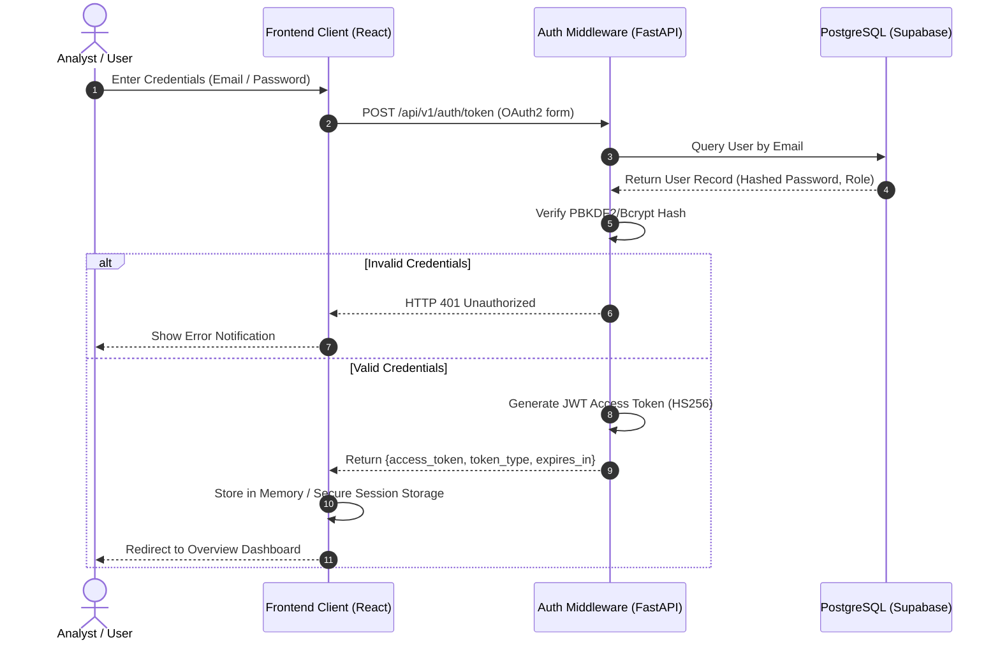

---

## 2. Company Search & Symbol Autocompletion

### Workflow Description
Fast symbol and corporate name resolution across Indian equity markets (NSE and BSE).

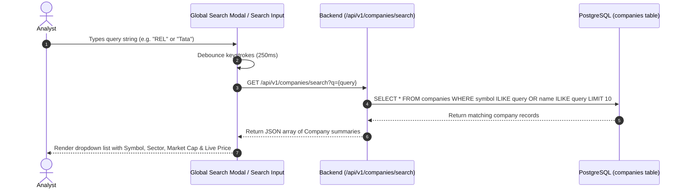

---

## 3. Company Overview & Financial Profile Retrieval

### Workflow Description
Aggregates fundamental accounting metrics, valuation multiples, historical stock prices, and corporate profiles into a unified company dashboard.

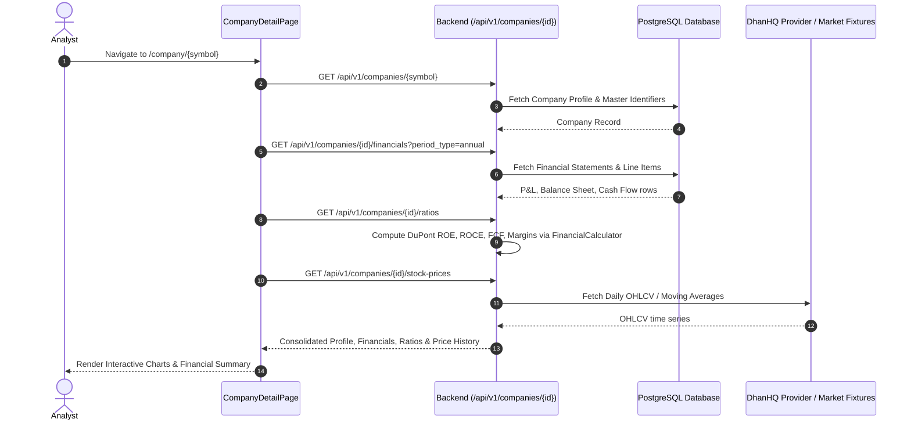

---

## 4. Financial Document Upload & File Validation

### Workflow Description
Multi-format file upload supporting Annual Reports, Quarterly Filings, Earnings Transcripts, and Presentation Decks in PDF, DOCX, XLSX, and CSV formats.

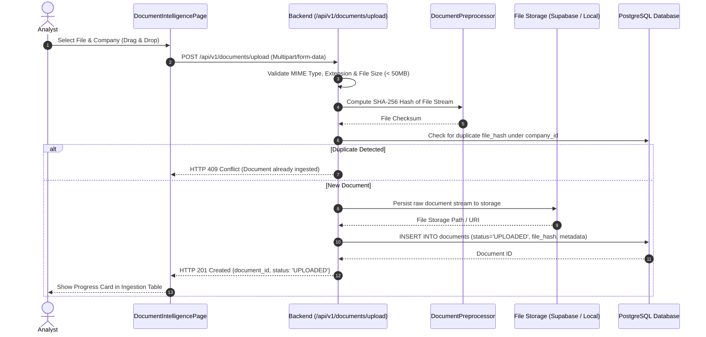

---

## 5. Document Extraction, Cleaning & Section Classification

### Workflow Description
Multi-modal extraction pipeline parsing textual hierarchies and tabular financial statements.

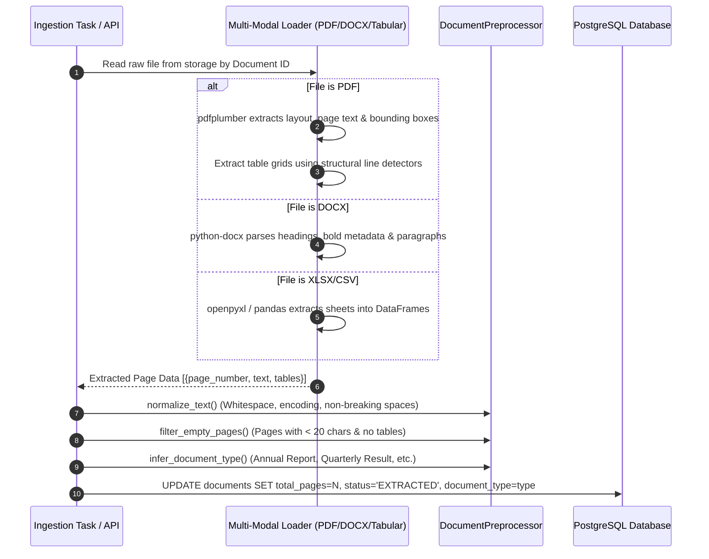

---

## 6. Financial-Aware Chunking & Embedding Generation

### Workflow Description
Sections documents into semantically coherent passages while preserving financial tables as unbroken Markdown blocks and computing 384-dimensional dense vectors.

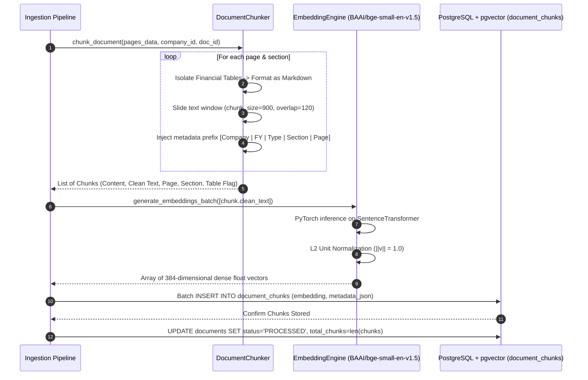

---

## 7. Vector Retrieval & Semantic Similarity Search

### Workflow Description
Cosine distance search against `document_chunks` using PostgreSQL `pgvector`.

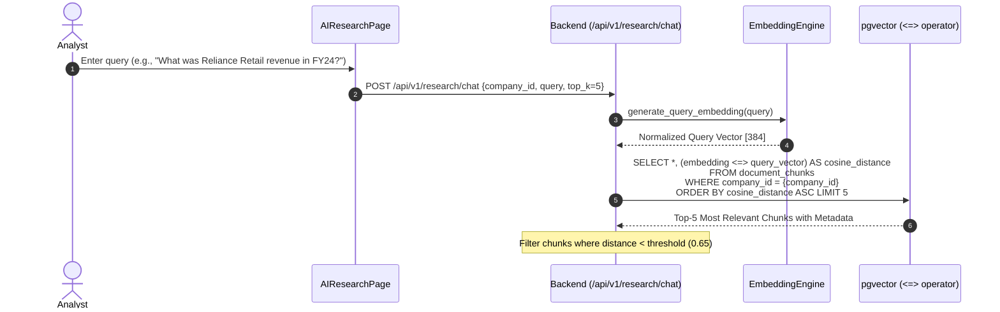

---

## 8. AI Question Answering & Citation Synthesis

### Workflow Description
Orchestrates retrieved evidence into a structured system prompt, invokes Google Gemini (or Groq), and constructs verifiable page-level citations.

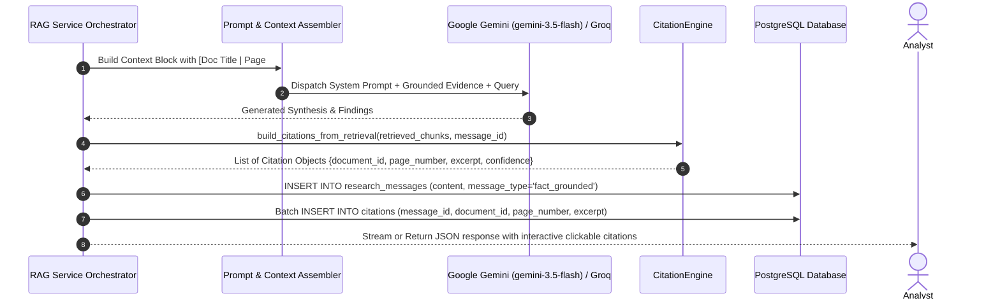

---

## 9. Deterministic Financial Analysis Workflow

### Workflow Description
Computes standard equity research ratios with strict zero-division prevention.

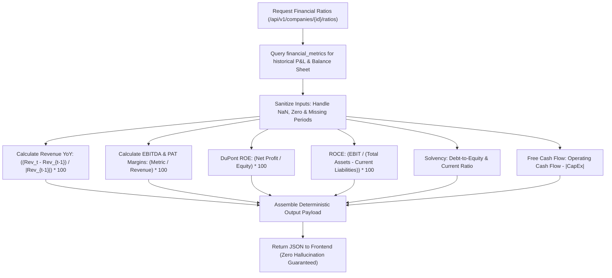

---

## 10. Performance Forecasting & Econometric Scenario Generation

### Workflow Description
Executes walk-forward cross-validation, models baseline trends, and projects Bull, Base, and Bear scenarios with 80% and 95% parametric confidence intervals.

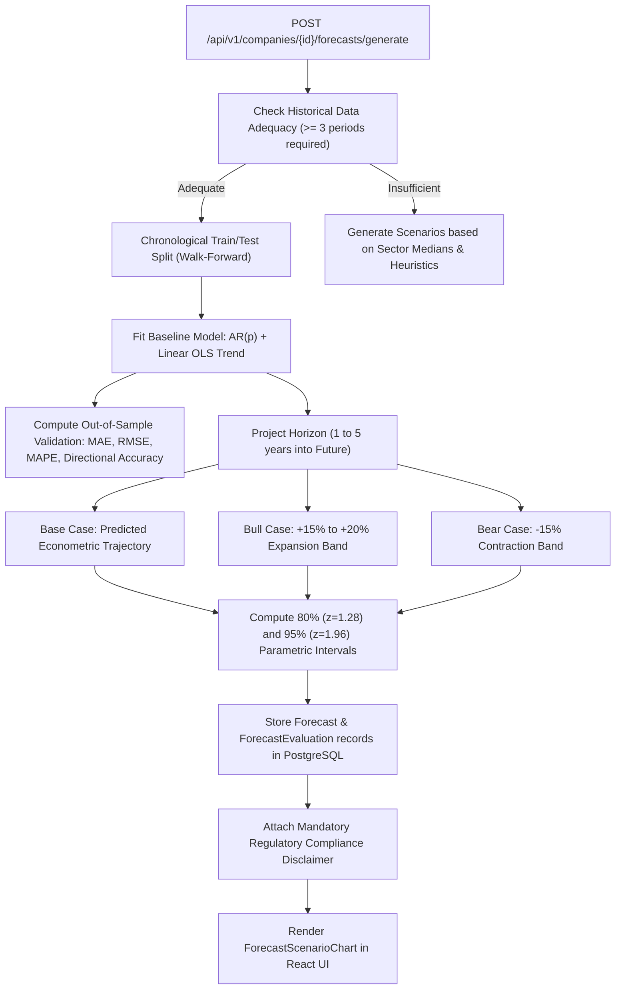

---

## 11. News Retrieval, Entity Matching & Tone Sentiment Analysis

### Workflow Description
Pulls live market news, classifies events, calculates sentiment tone, and prevents ticker collisions.

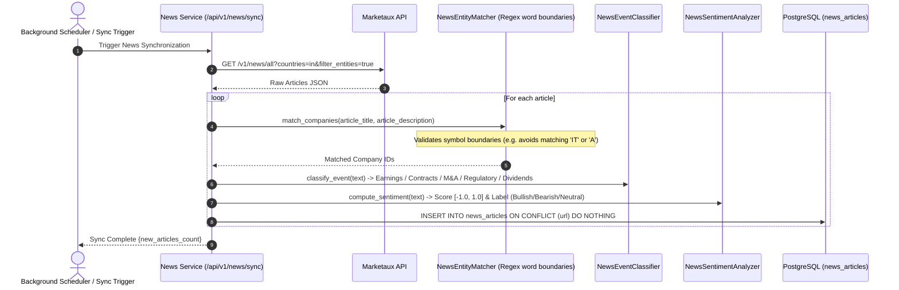

---

## 12. Corporate Actions & Market Event Tracking

### Workflow Description
Monitors dividends, stock splits, bonus shares, rights issues, and major contracts/deals.

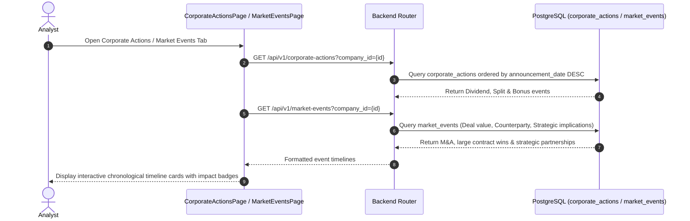

---

## 13. Peer Comparison & Sector Benchmarking

### Workflow Description
Compares 2 to 5 companies across valuation multiples, growth rates, and margins.

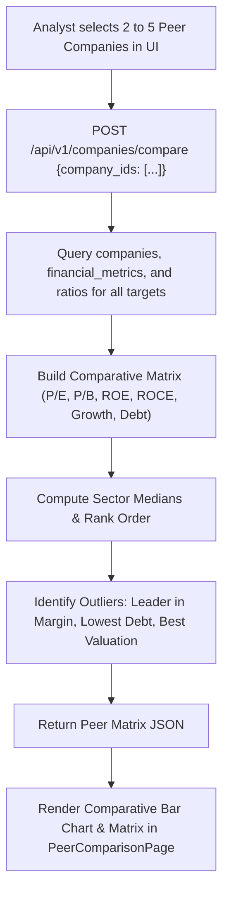

---

## 14. Stock Price History & Technical Indicator Generation

### Workflow Description
Retrieves daily candlestick OHLCV and derives 50-day & 200-day Simple Moving Averages.

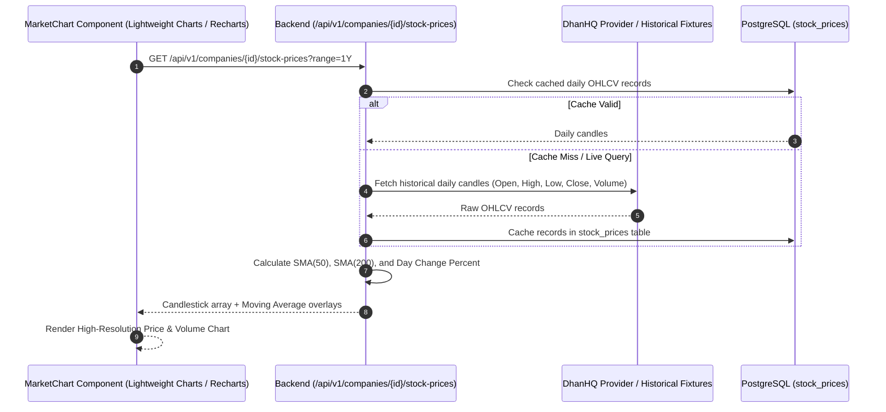

---

## 15. Research Report Synthesis Workflow

### Workflow Description
Generates a comprehensive multi-page institutional equity research brief combining qualitative filing excerpts with quantitative ratios and forecasting scenario bands.

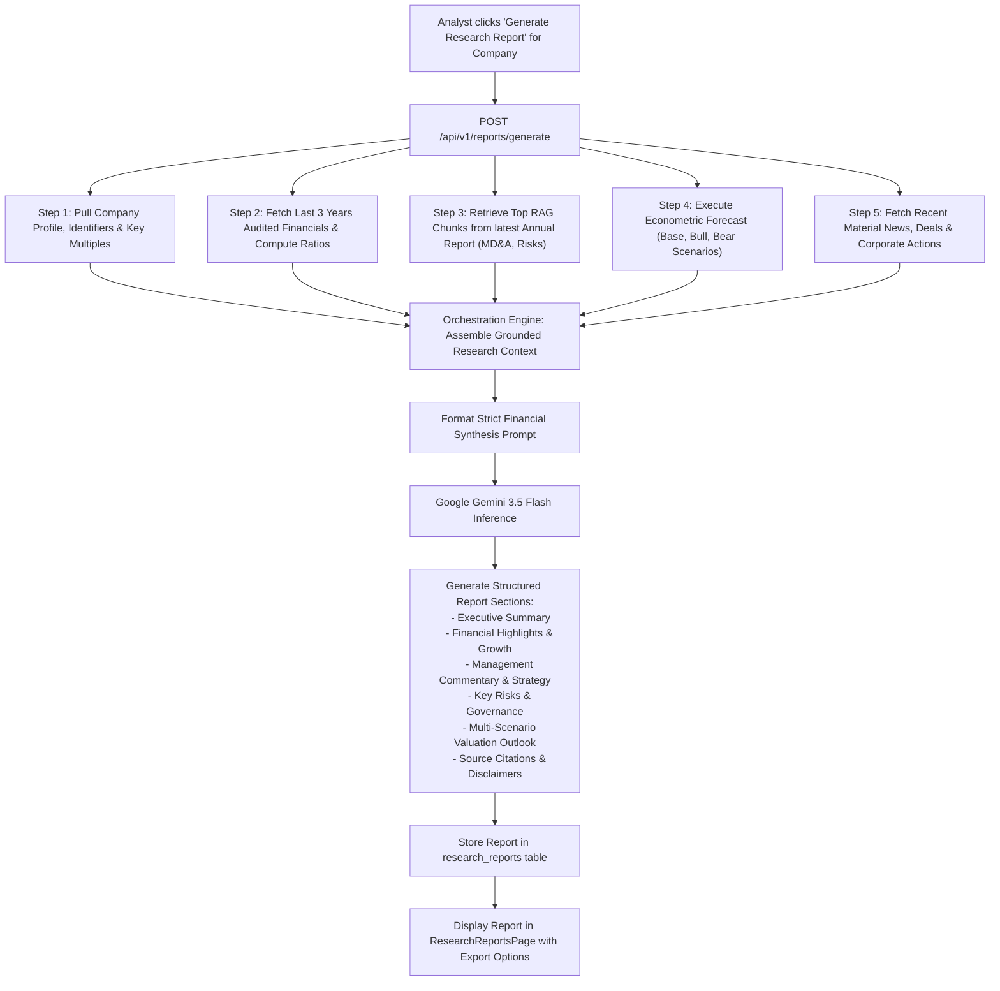

